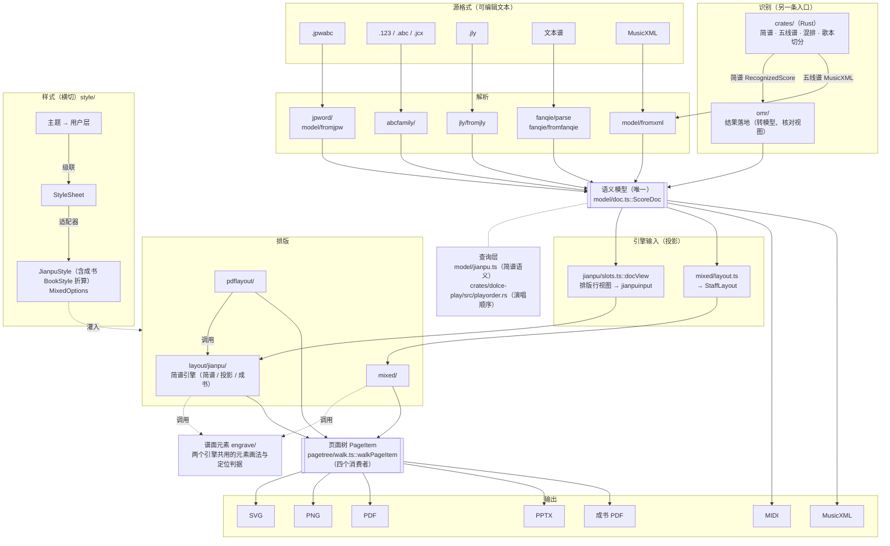

# 架构

> **技术栈、怎么构建、为什么这么分层、哪些决策不要推翻**。要做什么见 [需求.md](需求.md)；
> 每个模块的入口与判据见 [模块/](模块/)；阈值与踩坑全录在 [实现/](实现/)。

## 技术栈与构建

| 层 | 选型 |
|---|---|
| 外壳 | Tauri 2（Rust） |
| 前端 | TypeScript + Vite |
| 编辑器 | CodeMirror 6 |
| `.jpwabc` 解析 | 手写词法（`crates/dolce-formats/src/jpw/lex.rs`，门面 `src/jpword/lex.ts`，见 [源格式-jpwabc](模块/源格式-jpwabc.md)） |
| 渲染 | 原生 SVG DOM |
| 字体 | Bravura（SMuFL，`public/redist/`）+ 系统中文字体 |

前置：Node ≥ 20、Rust（含 cargo）。

```bash
npm install
npm run dev            # Vite 开发服务器（仅前端）
npm run tauri dev      # 跑桌面应用（需 Rust）
npm run build          # tsc 严格检查 + 打包（out/dist/，Tauri 的 frontendDist 与 Pages 部署都取这里）
npm run build:cli      # vite.cli.config.ts：Node ESM（out/cli/）给无头脚本 import；排版走 out/cli/engrave.js（不起浏览器）
npm run build:wasm     # wasm（不入库）：网页版识别（crates/omr-wasm + PDFium → public/redist/omr/，桌面版跳过）与编辑器开机就载的 dolce-wasm（crates/dolce-wasm → public/redist/dolce/，网页、桌面、Node 的 out/cli 都要；.jcx 编解码的码表单出一份 dolce_jcx_wasm 同目录、网页按需载）；dev / build 开头自动调，`node scripts/build-wasm.mjs dolce` 只编后两份（走 `crates/Cargo.toml` 的 `wasm-dolce` 编译档：fat LTO，不过 wasm-opt——它让 gzip 后反而变大；按体积编量过太慢，见该档注释）。要 `rustup target add wasm32-unknown-unknown` 与同版本的 wasm-bindgen-cli
npm run build:native   # Node 侧量字原生模块 native/textmeasure（macOS CoreText / Windows DirectWrite，要 Rust）
npm test               # 单元测试（vitest 直接跑 src 源码；配置与用例在本地私有仓库）
cd crates && cargo test   # 识别（Rust 工作区）单元测试；识别回归 `cargo run --release -p dolce-omr-cli -- regress <档>`，见「识别-Rust」
npx tsc --noEmit       # 仅类型检查
cd src-tauri && cargo check   # 仅检查 Rust 侧
```

**程序产出一律放 `out/`**（整个目录不入库）：`dist/` 网页构建、`cli/` Node 侧构建、`pkg/` OMR 分发包、
`vision-ocr` 编译出的 Swift 工具，以及 `../dev/scripts` 回归与成书脚本的报告和缓存（`pdf/`、`staff/`、`pptx/`、
`pdf-diff/`、`pdf-pages/`、`phrase-cache/`、`pdf-layout.json` …）。新脚本的输出也往这里写，别再在仓库根下另开目录；
Rust 的 `src-tauri/target/` 照 cargo 惯例不动。

## 1. 架构决策（已定，勿轻易推翻）

| # | 决策 | 理由 |
|---|---|---|
| A1 | **渲染用 SVG**（不是 Canvas 2D / CanvasKit） | 页面树（`PageItem`/`Group`/`GraphicPath`/`GraphicLine`/`TextFrame`）直接映射 SVG DOM；矢量、可点选、可导出 |
| A2 | **测量后端可注入，量的是画出来的那支字** | 排版只经 `src/common/measure.ts` 量字，底层由注入的后端给：app 用浏览器（`measure.browser.ts`：SVG `getComputedTextLength` + canvas 墨迹，与渲染同一引擎）；Node（回归、出图，`cli/engrave.ts` 装配）用系统文字引擎（原生模块 `native/textmeasure`，实现在 `crates/dolce-text-native`：macOS CoreText、Windows DirectWrite），口径对齐浏览器——泛称按中文页面解析、SVG 空白折叠、`text-spacing-trim` 的相邻标点挤压、单字 advance 取 1/64；没有原生模块的平台退回字体文件（fontkit + opentype.js，`measure.font.ts`）。**回归以 Node 为准**，与浏览器的差在亚像素（一次性对账见本地私有仓库的 `layout-node-parity.mjs`）。不要 CanvasKit、不要 DPI 位图缩放 |
| A3 | **排版、渲染、模型、编辑全在前端 TS；识别全在 Rust** | 排版/渲染/模型/编辑都在 TS，同一套代码跑 Web 与桌面（**迁 Rust 进行中**：演唱顺序、断句、试听时间轴、MIDI 写出、`.jcx` 编解码、ABC 家族（123 / ABC / jcx）读写、格式能力表与丢失清单、断行读写、简谱排版行视图已在 `crates/dolce-play`、`dolce-formats`、`dolce-model`、`dolce-view`，网页与桌面经主线程 dolce-wasm 同步调，TS 侧只留门面 `score/play.ts`、`common/jcx.ts`、`abcfamily/parse.ts` / `emit.ts`、`convert/capability.ts`、`model/breaks.ts`、`jianpu/slots.ts`）；识别（简谱、五线谱、混排、歌本切分）在 Rust 工作区 `crates/`，桌面版原生调、网页版编 wasm、命令行 `omr-cli`，三端同一个入口 `omr-engine`，结果交 TS 落地（`omr/`） |
| A4 | **桌面外壳的 Rust 只做原生能力** | PDF 导出（`svg2pdf` + `lopdf`）、识别（`crates/omr-engine`，OCR 走 ONNX Runtime 原生会话池、PDF 走 PDFium）、macOS MIDI 播放；文件 IO 与对话框用 Tauri 插件。Node 侧另有一个 N-API 模块，只给回归与出图用、不进 app：`native/textmeasure`（系统文字引擎量字与字形轮廓） |
| A5 | **一个语义模型 `ScoreDoc`，排版引擎只吃它的投影** | 各格式读进同一份模型，引擎输入（简谱的排版行视图 `jianpu/slots.ts::docView`、五线谱版面态 `StaffLayout`）由它投影、不另存语义；MusicXML 存回时没改过给原文，改过整份重写（不再 patch）。**MusicXML 独有的表层不进模型**：读入端把模型对象按身份（`_oid`）绑到原节点，原树与绑定表留在 Rust（`crates/dolce-model` 的 `xmlsurface`，TS 镜像经 `model/rustdoc.ts` 旁表记身份），五线谱引擎经查询函数（`model/xmlsurface.ts` 门面）现读，写出端按「写出端管的」之外通用回填。**MusicXML 只有一份写出端**（Rust `toxml`，TS 门面 `model/toxml.ts`），读写 MusicXML 不用浏览器 DOM（自有 XML 树 `crates/dolce-xml`） |
| A6 | **识别两条路线共用底层 crate，只向下依赖** | 简谱（`omr-jianpu`）、五线谱含混排与矢量档（`omr-staff`）共用 `omr-core`（图像、几何、像素内核）、`omr-sheet`（谱面元素、原语、曲线、满拍）、`omr-text`（文法、页眉、歌词）、`omr-ocr`、`omr-source`（PDFium 取数）；原语只写一份，两路各自的判据留在各自 crate。TS 侧的 `omr/` 只做结果落地，不含判据 |

## 2. 分层



## 3. 两个共用契约

**改这两处要格外当心——它们是多条路的交汇点。**

### 3.1 `ScorePainter`（`src/layout/painter.ts`）

全项目**唯一的排版器**：按请求排版并提交结果，管页面渲染（DOM 映射）、点选与播放高亮。请求两种——
简谱（`JianpuPaintRequest`：整份 `ScoreDoc` 交给简谱引擎 `layout/jianpu/`，简谱 / 投影档，各种格式同一条；帮助谱例、PPTX 也走它，
成书经 `pdflayout/browser.ts` 直接调引擎）、五线谱 / 混排（`StaffPaintRequest`，异步、带版本核验）。
排页算法各在各的模块，这里只管请求版本、结果提交（`LayoutResult`，`layout/result.ts`）与交互状态；
交互查询一律按**元素 id + 遍次**（`entryEl` / `lyricEl` / `partEls` / `highlight` / `pageOf` / `headerParts`），
身份索引按图元上的身份标签收（`pagetree/identity.ts` / `scoreindex.ts`），播放线在 `layout/playhead.ts`。
简谱走同步 `loadSync`（构造时 SMuFL 字体已就绪，不需要等资源），只有五线谱／混排是异步、带版本核验；目前没有路径需要为其余部分等待资源，真要等资源时再把
重排链（`App.reload` → `App._reloadScoreDoc` / `.jpwabc` 适配器的 `reload`）Promise 化。

### 3.2 `walkPageItem`（`src/pagetree/walk.ts`）

页面树的**唯一遍历骨架**，四个消费者共用：SVG DOM 两路（`svgVisitor` / `mixedVisitor`）、
成书 DrawList（`pdflayout/browser.ts`）、PPTX 形状（`editor/pptx.ts`）。

> 骨架只管「怎么走」，**坐标与颜色语义由各自 visitor 决定**——`mixedVisitor` 把 matrix 加在**叶子**上、
> 线与文字写死 black、只递归 Group；`svgVisitor` 每个 item 都产生 `<g>`、颜色取 item、无条件递归。
> **这些差别不许收进骨架。**

## 4. 数据流

| 源 | 路径 |
|---|---|
| `.jpwabc` | `JpwFile.fromString` → `jpwToScoreDoc` → `ScoreDoc` → `ScorePainter`（简谱引擎，简谱／投影；`.Layout` 只管投影档） |
| `.123` | `parse123` → `ScoreDoc` →（`jianpu/slots.ts` 排版行视图）→ `ScorePainter`（简谱引擎，简谱／投影，单声部多声部同一条） |
| 文本谱 | `parseFanqie` → `ScoreDoc`（内部经语法树 `parseFanqieAst` → `fanqieToScoreDoc`）→ 同 `.123`；乐句重排读模型上的原文区间改写原文 |
| MusicXML | 打开：`loadScoreDoc` → `ScoreDoc` → 同 `.123`（简谱档）／同一份 `ScoreDoc` → `layoutStaff` → `StaffLayout`（版面态）→ `ScorePainter`（五线谱/混排），**无代码区**；改动经 `toxml.ts` 整份重写 |
| `.abc` | `parseAbc` → `ScoreDoc` → 同 `.123`；读不动直接报错 |
| `.jcx` | `decodeJcx`（`crates/dolce-formats/src/jcxcodec.rs`，GBK/BIG5/UTF-8）→ `parseJcx`（ABC 家族第三个方言）→ `ScoreDoc` → 同 `.123`；写出 `emitJcx` → `encodeJcx`（`%MUSE2` + GBK） |
| `.jly` | `parseJly`（`crates/dolce-formats/src/jly/fromjly.rs`，门面 `jly/fromjly.ts`）→ `ScoreDoc` → 同 `.123`；写出 `emitJly`（`jly/tojly.ts`，走简谱输入模型 `jianpuInputOfDoc` / `jianpuInputOfJpw`）；「按乐句重排」只重断曲行（`rewrapJlyText`） |
| MIDI | `crates/dolce-formats/src/midi/`（`smf.rs` 读事件 → `import.rs` 量化建模，门面 `midi/import.ts`）（MusicXML 形状的 `ScoreDoc`）→ `toxml.ts` → 同 MusicXML 打开（`editor/midi-import.ts`，转成设置里的默认编辑格式）；不另写 MusicXML 写出端 |
| 简谱图片/PDF | Rust 识别（`omr-jianpu`）→ `RecognizedScore` → `omr-todoc::jianpu` → `ScoreDoc` → 123 核对文本（或 JPWABC / ABC / 文本谱 / jianpu-ly / Muse `.jcx`，同一张转换目标表） |
| 五线谱 PDF / 图片 | Rust 识别（`omr-staff`：位图 / 矢量 / 转曲矢量三档同一条路线，混排页带简谱互证）→ MusicXML + 核对 JSON（`omrrust/adapter.ts`）→ `loadScoreDoc` → 混排视图（谱面上改模型） |
| 成书 | MusicXML → `ScoreDoc`（`pdflayout/browser.ts::bookDocOf`，只留主旋律）+ 断句（`dolce-view/src/phrasedoc.rs`，断点按元素 id 写回文档）→ 简谱引擎 `book` 开关 → 页面树 → DrawList → PDF |
| 试听/MIDI | `ScoreDoc` → `dolce-view/src/playsong.rs::play_source_of`（按形状分给 `playSourceOfDoc` / `playSourceOfSong`）→ `buildTimeline`，高亮按元素 id |

## 5. 模块地图

| 目录 | 职责 | 模块文档 |
|---|---|---|
| `src/model/` | **语义模型 `ScoreDoc`**（六种格式共用）+ MusicXML / `.jpwabc` 进出 + 简谱语义层 + 记号名字表（`marknames.ts`）。**只向下依赖**（common / smufl / score / i18n / jpword），各格式、投影、跨格式操作都在它之上 | [模型-scoredoc](模块/模型-scoredoc.md) |
| `src/convert/` | **跨格式操作**：转换目标表（`targets.ts`）、格式能力表与保存前丢失清单（`capability.ts`）、`.jpwabc` 写出入口（`jpwabc.ts`，按形状选投影）；在 model、各格式与投影之上，识别输出、格式下拉、另存为共用 | [导出](模块/导出.md) |
| `src/abcfamily/` | **ABC 家族**（含简谱主格式 123）：读写在 Rust `crates/dolce-formats/src/abc/`，这里只留门面（`parse.ts` / `emit.ts`）与 123 高亮 | [源格式-abc家族](模块/源格式-abc家族.md) · [源格式-123](模块/源格式-123.md) |
| `src/midi/` | **MIDI 导入**门面（`import.ts`）：SMF 读取与量化成谱（按拍在 1/16 与三连音间择优、按小节分声部、按调号拼音名）在 `crates/dolce-formats/src/midi/`；导出 MIDI 在 `crates/dolce-play/src/midi.rs` | [模型-scoredoc](模块/模型-scoredoc.md) |
| `src/score/` | 演唱顺序、乐句断句、试听时间线、MIDI 写出的**门面**（`play.ts`：判据在 Rust `crates/dolce-play`，经 dolce-wasm 同步调；这里只编解码输入形状、按下标认回对象）与胶水用的形状（`playtypes.ts`、`phraseinput.ts`）+ 调号音高工具（`jppitch.ts`） | [排版-简谱引擎](模块/排版-简谱引擎.md) · [播放](模块/播放.md) |
| `src/jpword/` | `.jpwabc` 分段与 `.Voice` 词法的门面（判据在 `crates/dolce-formats/src/jpw/`）、高亮用的记号种类（`tokens.ts`） | [源格式-jpwabc](模块/源格式-jpwabc.md) |
| `src/fanqie/` | 文本谱：方言、解析、写出的门面（`dialect.ts` / `parse.ts` / `tofanqie.ts`，判据在 `crates/dolce-formats/src/fanqie/`）、原文重排的门面（`relayout.ts`，实现在 `fanqie/relayout.rs`）、高亮 | [源格式-文本谱](模块/源格式-文本谱.md) |
| `src/jly/` | jianpu-ly：读与和弦记法的门面（`fromjly.ts` / `jlychords.ts`，判据在 `crates/dolce-formats/src/jly/`）、写（`tojly.ts`，走简谱输入模型） | [源格式-jianpu-ly](模块/源格式-jianpu-ly.md) |
| `src/layout/` | **简谱引擎**（`layout/jianpu/`：`place/` 定位、`compose/` 绘制，各格式的简谱 / 投影档与成书）+ 排版器 `ScorePainter`（两个引擎之上的调度）+ 身份索引与播放线 + SVG 绘制 | [排版-简谱引擎](模块/排版-简谱引擎.md) |
| `src/engrave/` | **谱面元素**：小节线、调号、临时记号、八度点与减时线叠层、倚音、连音、弧、和弦、歌词音节、力度与奏法…每种一份画法与定位判据，简谱与五线谱混排两个引擎调它；简谱专属的页面树叶子（数字、八度点、减时线、歌词、弧）也在这里。不依赖任何引擎 | [排版-谱面元素](模块/排版-谱面元素.md) |
| `src/jianpu/` | **简谱投影层**：元素形状（`ast.ts`，文本谱解析器产出、排版行视图沿用）、排版行视图 `slots.ts::docView`（门面，铺排在 Rust `crates/dolce-view`）、简谱输入模型 `jianpuinput.ts`、断句与试听输入（`dolce-view/src/phrasesong.rs`/`dolce-view/src/playsong.rs`）、断点落行与写回原文的门面（`phrase.ts`/`applybreaks.ts`/`docrelayout.ts`，实现在 `dolce-view/src/{phraselines,bookbreaks}.rs`、`dolce-play/src/applybreaks.rs`、`dolce-formats` 的 `jpw/relayout.rs` / `abc/comments.rs`）；「投影/简谱」两档的公共语义（`walkPlay` 门面，实现 `dolce-play/src/walk.rs`；`paginate`）。依赖 model / score，不依赖任何源格式目录 | [排版-投影与简谱两档](模块/排版-投影与简谱两档.md) · [排版-简谱引擎](模块/排版-简谱引擎.md) |
| `src/mixed/` | 五线谱/混排模型与渲染（移植原 C++ 工程），与简谱引擎平级、互不依赖 | [排版-五线谱混排](模块/排版-五线谱混排.md) |
| `src/style/` | **样式层**：`StyleSheet`、单位（em/pt/sp）、级联、内置主题与风格，两把尺子的适配器，成书的书籍样式 `BookStyle`（`bookstyle.ts`） | [样式与设置](模块/样式与设置.md) |
| `src/pdflayout/` | 成书/歌集级版面、书级元数据、书籍样式统计（`stats.ts`）；矢量 PDF 对象层与归类（`vector.ts`、`vectext.ts`、`inventory.ts`、`bookprofile.ts`、`glyphdict.ts`，给私有仓库的版面核对脚本） | [排版-成书](模块/排版-成书.md) |
| `src/omr/` | **识别结果落地**：结果类型（`types.ts`）、简谱结果转模型的门面（`todoc.ts`，实现在 `crates/omr-todoc`）与各格式写出端（`emit.ts`）、参照歌词互证（`reflyrics.ts`）、核对视图（简谱 `overlay.ts`、五线谱 `staffoverlay.ts` / `review.ts`）。识别本身不在这里 | [识别-Rust](模块/识别-Rust.md) |
| `src/omrrust/` | 识别引擎的 TS 外壳：判宿主（桌面 Tauri 命令 / 网页 wasm Worker）、请求编码、五线谱会话产物 → 核对数据（`adapter.ts`） | [识别-Rust](模块/识别-Rust.md)「接入」 |
| `src/editor/` | 编辑器控制器、**源格式适配器表**、双向定位（`sync.ts` 只排序与查询，建表在 `dolce-view/src/sync.rs` / `dolce-model/src/xmlsync.rs`）、可视化编辑、导出（含 MusicXML 导出版面 `xmllayout.ts`）、播放、OMR 控制器 | [编辑器](模块/编辑器.md) · [可视化编辑](模块/可视化编辑.md) · [播放](模块/播放.md) · [导出](模块/导出.md) |
| `src/pagetree/` | **页面树**：通用图元 `PageItem`/`Group`/`GraphicPath`/`GraphicLine`/`TextFrame`/`SmuflText`、字体 `Font`、图元身份、遍历骨架 `walkPageItem`；排版与各输出之间的契约，只认几何与字体 | [排版-简谱引擎](模块/排版-简谱引擎.md) |
| `src/common/` | 测量（**核心**：`measure.ts` 缓存与挤压规则，后端 `measure.browser.ts` / `measure.font.ts`）、几何、路径包围盒、分数、CJK 标点、扩展名白名单；dolce-wasm 实例与绑定形状（`dolce.ts` / `dolcewasm.ts`，网页 `main.ts` 开机载、Node 由 `cli/dolcewasm.node.ts` 载）、`.jcx` 编解码门面（`jcx.ts`） | — |
| `src/smufl/` | Bravura 元数据 + GlyphCodes | — |
| `src/cli/` | Node CLI 入口：`engrave.ts` 排版（装测量后端与 SVG 出口，导出无头排版会话 `editor/headless.ts`）、`omrfmt.ts` 识别结果写出（OMR 分发包）、`j123.ts` 格式与模型、`index.ts` 矢量 PDF 与样式；`*.node.ts` 只许进这些入口 | — |
| `crates/` | **Rust 工作区**。识别：`omr-engine` 三端入口、`omr-jianpu` 简谱、`omr-staff` 五线谱、`omr-book` 歌本切分、`omr-cli` 命令行与回归、`omr-wasm` 网页版绑定，底层 `omr-core` / `omr-sheet` / `omr-text` / `omr-ocr` / `omr-source`。模型 / 格式 / 排版（迁移中）：`dolce-base`（JS 数值口径、分数、UTF-16 区间）、`dolce-xml`、`dolce-play`（演唱顺序、断句、时间轴、MIDI）、`dolce-formats`（`.jcx` 编解码、ABC 家族读写、格式能力表）、`dolce-session`、`dolce-wasm` / `dolce-cli` 宿主壳；排版地基（L0，TS 排版仍在用 TS 那份，这几个先供对拍）：`dolce-geom`（矩形、矩阵、路径包围盒）、`dolce-smufl`（Bravura 码位与元数据）、`dolce-text`（量字缓存、标点挤压、浏览器口径层、录放后端）、`dolce-text-native`（CoreText / DirectWrite）、`dolce-scene`（页面场景与两种 SVG 方言）；`cd crates && cargo test` | [识别-Rust](模块/识别-Rust.md) |
| `native/textmeasure/` | Node 侧量字原生模块（napi 外壳，系统文字引擎的实现在 `crates/dolce-text-native`），`npm run build:native`；改了原生模块后手动跑 CI（`.github/workflows/native.yml`，`gh workflow run native.yml`）在 macOS 与 Windows 上编译并跑冒烟测试 | — |
| `src-tauri/` | Tauri 2 外壳 + 三块原生能力 | [编辑器](模块/编辑器.md) |
| `public/redist/` | Bravura 字体与 SMuFL 元数据；`soundfont/` 试听的钢琴音色 | — |

目录间只算运行期导入，没有文件环、目录间没有双向依赖：`node ../dev/scripts/deps-check.mjs`（随 `npm test` 跑）守门，白名单已清空、不许再加；`model/` 只向下依赖（A5，白名单 common / smufl / score / i18n / jpword）、`omr/`（识别结果落地）不依赖编辑器与引擎外壳，写成方向规则；另有 `pagetree/` 只认 common / smufl / model、`engrave/` 不依赖引擎、两个引擎（`layout/jianpu`、`mixed/`）互不依赖。

## 6. 两条主线

### 6.1 模型主线

**已收敛到一个模型**：`src/model/doc.ts` 的 `ScoreDoc` 装得下和弦、力度、多声部、版面坐标、断行，
六种格式都读进它、从它写出。两个排版引擎各自只留引擎内部结构：

| 引擎 | 读什么 | 内部结构 |
|---|---|---|
| 简谱（`layout/jianpu/`） | 整份 `ScoreDoc` 的排版行视图（`jianpu/slots.ts::docView`：页 → 组 → 声部行，元素带 id），多声部同一条 | 定位结构 `PlacedPage` / `PlacedGroup` / `PlacedVoice`（`place/model.ts`），绘制出类型化图元 |
| 五线谱混排（`mixed/`） | `mixed/layout.ts::layoutStaff` 从 `ScoreDoc` 建的版面态 | `StaffLayout` 及各 `*Layout` 节点（带 `src` 引用模型元素） |

派生量（唱名、减时线、调号上下文、演唱顺序）不存进模型，经查询层取（`model/jianpu.ts`、`crates/dolce-play/src/playorder.rs`）。
`jianpu/jianpuinput.ts` 投影出的 `JScore`（`layout/input.ts`）不再喂排版引擎，只留给 jianpu-ly 写出、断句、识别对歌词这些按「和弦序列」处理的地方。
分工、判据与改模型要守的原则见 [模块/模型-scoredoc.md](模块/模型-scoredoc.md)。

### 6.2 样式主线

**入口收成一个**：`src/style/` 的 `StyleSheet`。内置主题（`themes.ts`：projection / print / book / staff）
叠上用户层（编辑器面板），或歌本样式表（`.ss`；成书的 `BookStyle` 也由它算出），
经 `cascade.ts::computeStyle` 按上下文（档位 / 引擎 / 分页 / 页位 / 段号）得到 computed 样式表，再由适配器折成尺子：

| 尺子 | 位置 | 适配器 | 服务对象 |
|---|---|---|---|
| `JianpuStyle` | `src/engrave/jianpustyle.ts` | `style/jianpu.ts::jianpuStyleOf`（预设 original / pptx）；成书 `style/book.ts::bookJianpuStyle(BookStyle)` | **简谱一个引擎、一把尺子**：各格式的简谱档、投影档、PPTX、成书。全是 pt；引擎另带按音符字号缩放的栅格（`layout/jianpu/metrics.ts::JianpuGrid`，挂着这把尺子） |
| `MixedOptions` | `src/mixed/model.ts` | `style/staff.ts` | 五线谱 / 混排（tenths） |

同一档里各格式用同一套样式值（用户定，2026-10 简谱合并：原先简谱引擎 `LayoutOptions` 与原样文档布局 `JianpuMetrics` 两把尺子、
同一份谱换个格式字号线宽都变；`dev/scripts/ruler-compare.mjs` 逐项核对各格式生效值全等）。
`BookStyle` 只是成书的输入数据（从原书统计中位数得来），折成 `JianpuStyle` 后与别的档同一个引擎。
`MixedOptions` 不并入，也不从 `JianpuStyle` 折算（用户定 2026-10-14）：同名键在样式表层面已经两边共享（`style/keys.ts` 两列都填），混排走自己那条级联（`editor/app.ts::staffStyle`），简谱档的风格、音符字体、和弦升降号不进来，几项出厂值也照混排自己的（见 [样式机制.md](样式机制.md) §1）。

**谱面元素的规则不跟着尺子分家**：同一种元素（八度点、临时记号、连音、弧、歌词音节…）怎么画、相对数字墨迹盒落在哪，
只在 `src/engrave/` 写一份；两个引擎把自己的尺子折成元素的参数（字号、墨迹高、颜色、线宽）、给出锚点坐标，
横向排布、分页、上方带堆叠这些**整行级**算法才留在引擎里。改一种元素的观感改 `engrave/`，两路一起变，
别在某个引擎里另写一份（详见 [排版-谱面元素](模块/排版-谱面元素.md)）。

**简谱引擎两段式**：`place/` 只定位（只碰注入进来的量具 `InkMeasurer`，所有 y 在这一段定死），`compose/` 只绘制（产出类型化图元、打身份标签）。
播放与身份索引不在引擎里：引擎只给图元打 `ItemIdentity` 标签，`layout/scoreindex.ts` 收、`layout/playhead.ts` 管播放线。

## 7. 平台与打包

- **Web**：Vite 打包，GitHub Pages 部署
- **桌面**：Tauri 2（macOS `.dmg` / Windows `.exe`）；新增插件要同改的四处、Windows 内置 VC++ 运行库见 [编辑器](模块/编辑器.md)「Tauri 外壳」
- **更新检查与反馈入口**（只在桌面版，帮助对话框的「关于」页）：查 GitHub Releases 比版本号 + `mailto:`，
  为什么不上 updater 插件、节流判据见 [编辑器](模块/编辑器.md)「更新检查与反馈入口」
